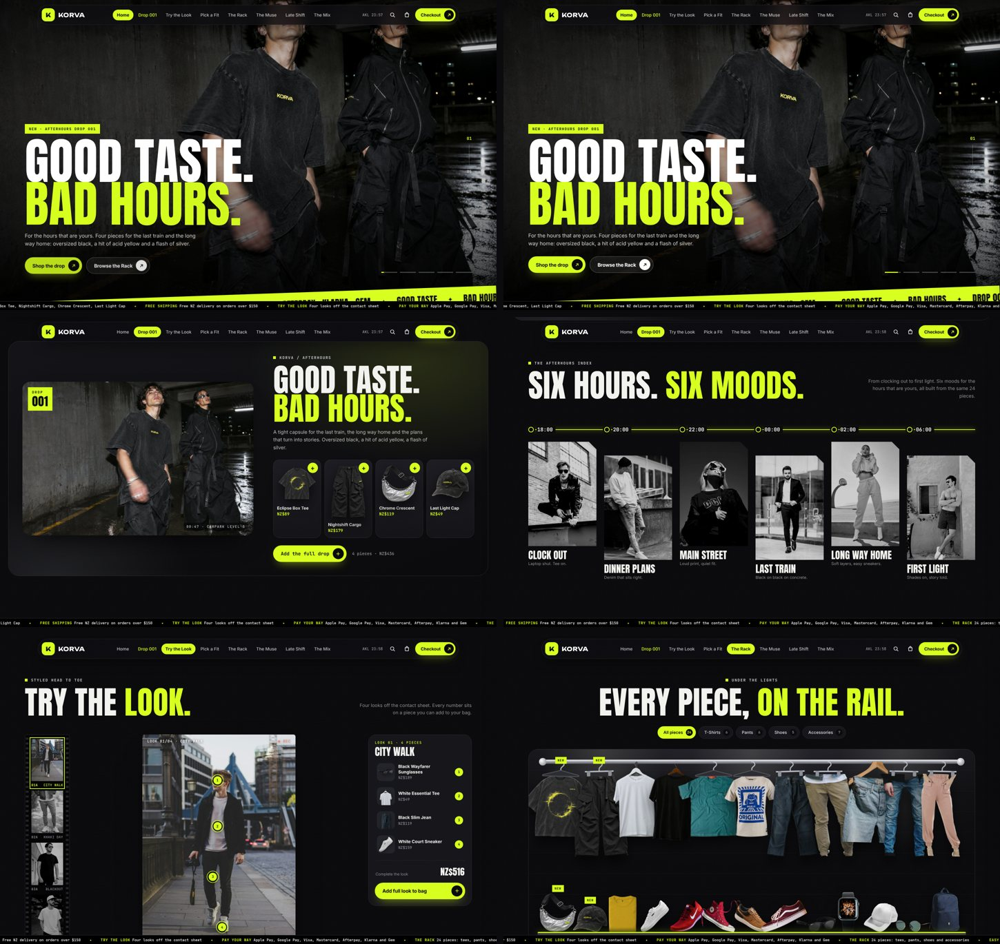

# KORVA — storefront

A static fashion store for T-shirts, pants, shoes and accessories, priced in New Zealand dollars, with a checkout page.

Live site: https://rukshanm123-art.github.io/korva-store/



## Run locally

No build step. Serve the folder and open it in a browser:

```bash
python3 -m http.server 8080   # then open http://localhost:8080
```

## The catalogue

24 products, all defined in `data.js`: the 4-piece AFTERHOURS Drop 001 plus 5 per category. Every section of the site reads from that one list, so a product's name, photo and price match everywhere: the looks, the cards, the rack, the reels, the bag and the checkout.

| Category | Products |
| --- | --- |
| AFTERHOURS Drop 001 | Eclipse Box Tee, Nightshift Cargo, Chrome Crescent, Last Light Cap |
| T-shirts | White Essential, Black Crest (front and back), Teal Pocket, Lucky Cat Print, Mustard Heavyweight |
| Pants | Black Slim Jean, Khaki Chino Jogger, Light Wash Straight Jean, Mid Blue Skinny Jean, Blush Cargo Jogger |
| Shoes | White Court Sneaker, Crimson Knit Runner, Cherry Canvas High-Top, Tan Canvas Court, Maroon Skate Low |
| Accessories | Black Wayfarer Sunglasses, Midnight Sport Watch, White Trucker Cap, Round Gold Sunglasses, Navy Day Backpack |

Product images are cut-outs (transparent WebP) in `assets/products`. Prices are NZD and include GST.

## Sections

The whole site follows the AFTERHOURS identity: night concrete, silver and acid yellow, condensed headlines, hard camera-flash effects and short copy.

1. Intro: a clock counts down to midnight, camera flashes reveal the drop pieces, the KORVA wordmark lights up in acid yellow and shutter blinds open onto the store
2. Hero slideshow led by the AFTERHOURS campaign, with a live Auckland clock in the nav
3. AFTERHOURS Drop 001: campaign photo, the four pieces and "Add the full drop"
4. The Fitting Room: tabs for tees, pants and shoes. Tees and pants hang on a curved rail (pants on clip hangers) and shoes sit on a lit shelf. Pieces swing forward one at a time, with a soft shadow on the wall and a product card (sizes, Add to bag, the full look). Switch to "On model 360°" to see the piece worn by a model who turns all the way round (a closer camera for pants and shoes); drag to rotate. Each look has a real 360° turnaround video (assets/fitting/o1–o4, WebM and MP4, seamless loops made with the free Wan 2.2 model) that plays full-scene; the 8-angle frames are the fallback. The model views are 8-angle turnarounds in `assets/fitting`, generated with AI from the product photos
5. Six hours, six moods: a timeline from 18:00 (Clock Out) to 06:00 (First Light) with black-and-white flash photos that turn to colour on hover
6. Try the Look: a contact sheet of four looks beside a large frame, where numbered hotspots sit on the actual items and match the piece list
7. Pick a Fit: a 3D card deck with all 24 products in charcoal, silver and acid
8. The Rack: under spotlights, tees and pants hang on a chrome rail and shoes and accessories sit on a lit shelf; the drop hangs first, marked NEW
9. Clock out. Switch on.: draggable product cards and outlined marquee lines
10. Caught in the flash: a film with flash cuts and a running timecode between black-and-white photo columns
11. Style, after hours: reels and a story viewer, each selling a product visible in the photo
12. The Late Shift: best sellers on a fan of arches
13. Three pieces. One night.: pick any three tees or pants, watch them weave together, get 10% off
14. Footer with a live clock, accepted payment methods and a bag drawer with quantities, free-shipping progress and Afterpay pricing

## Checkout (`checkout.html`)

- NZ contact and delivery details (regions, 4-digit postcodes, NZ mobile numbers)
- Shipping: NZ Post standard (free over NZ$150, otherwise NZ$8), express courier NZ$15, Click & Collect free
- Payment: Apple Pay, Google Pay, Visa and Mastercard (number formatting, card-type detection, Luhn and expiry checks), Afterpay (4 payments, up to NZ$2,000), Klarna (pay in 4 or in 30 days), Gem Interest Free (6 months, orders over NZ$250)
- An AFTERHOURS upsell in the order summary for drop pieces not yet in the bag
- Discount codes `KORVA10` (10% off) and `KIAORA` (15% off), GST shown, order confirmation

**Test mode:** the checkout is a working front end only. No money is taken and card details never leave the browser. To take real payments, connect providers where `completeOrder` is called in `checkout.js`. For example, Stripe can handle cards, Apple Pay and Google Pay. Afterpay, Klarna and Gem each need their own merchant account. Then remove the test-mode banner.

## Files

- `index.html`, `styles.css`, `app.js`: the store
- `checkout.html`, `checkout.css`, `checkout.js`: the checkout
- `data.js`: products, looks, content and the shared bag (saved in the browser's local storage)
- `weave.js`: the fabric-weave canvas
- `assets/products`: product cut-outs; `assets/looks` and `assets/img`: photography from Unsplash (Unsplash License)

## Deploy

`.github/workflows/pages.yml` publishes the site to GitHub Pages on every push to `main`, or on demand from the Actions tab.
